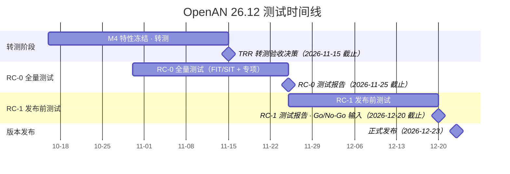
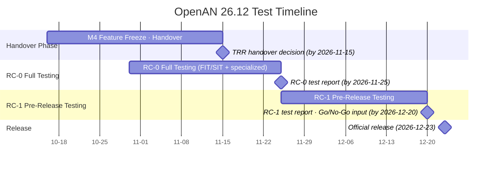

# OpenAN 集成测试工作组 Wiki 首页介绍

> 用途：OpenAN 集成测试工作组 wiki 首页（Confluence）简要介绍
> 说明：格式参考 TSC 页面（一句话定位→会议安排→单行链接→冒号式标题→成员表）；成员为占位符，按实际补充；职责条目取自《Integration Testing Process and Framework》§3

---

## 中文版

# OpenAN 集成测试工作组（Integration Testing Working Group）

OpenAN 集成测试工作组负责社区统一的集成测试质量保障体系，确保各工作组交付可集成的代码，并在版本发布前完成系统级质量验证。工作组会议对社区公开。

*会议安排：**待定***

[**TSC邮件列表**](https://lists.openan.dev/g/tsc) | [**GitHub**](https://github.com/project-openan/openan-itest) | [**Zulip**](https://linuxfoundation.zulipchat.com)

## 职责范围：

- 制定并维护集成测试流程规范：[集成测试流程及框架](https://lf-networking.atlassian.net/wiki/spaces/OpenAN/pages/1544945667/OpenAN+Integration+Testing+Process+and+Framework)、测试 Checklist、测试方案/用例/报告模板
- 组织测试方案与测试报告评审（TRR 决策、FIT 准出、发布质量评审）
- 执行 SIT 系统级集成测试与专项测试（性能、长稳、可靠性、安全、兼容性、A2A-T 协议专项测试等）
- 维护 `openan-itest` 测试仓库与自动化测试框架，为各特性 WG 提供用例模板与自动化支持
- 保障与核验测试环境，与 Infra WG 协作维护 CI 流水线与质量门禁
- 汇总各特性 WG 质量数据和出具版本测试报告，为 TSC 发布决策（Go/No-Go）提供输入

## 测试时间线（版本周期）：

> 各阶段前置条件、操作流程、工作组任务分工、交付物与验收内容的详细流程见《[集成测试流程及框架](https://lf-networking.atlassian.net/wiki/spaces/OpenAN/pages/1544945667/OpenAN+Integration+Testing+Process+and+Framework)》§4.3。

**OpenAN 26.12 测试时间线**（依据 [OpenAN 26.12 发布计划](https://lf-networking.atlassian.net/wiki/spaces/OpenAN/pages/1187905545/OpenAN+26.12)，2026-12-23 发布；以下为按发布日倒推的建议排期，以版本测试计划为准）：

| 阶段 | 时间点 | 特性工作组交付物 | 集成测试工作组交付物 |
|------|--------|----------------|---------------------|
| **转测（M4：测试设计与评审）** | M4 特性冻结起至 11-15 | 测试方案、测试用例表、FIT 自动化测试用例 | 转测评审意见与 TRR 结论 |
| **RC-0（全量测试与需求验收）** | RC-0 版本窗口 | FIT 自测报告、P0/P1 缺陷闭环记录 | RC-0 测试报告（全量 FIT/SIT + 专项测试）、需求验收结论 |
| **RC-1（发布前测试）** | RC-0 后至发布前 | 遗留问题清单与风险接受 | RC-1 测试报告与质量数据汇总（Go/No-Go 输入） |

## 当前工作组成员：

| 角色 | 姓名 | LF ID | 职责 |
|------|------|-------|------|
| Lead | Xunli Yang | @Xunli Yang | 负责工作组统筹，测试流程、测试计划与版本测试质量管理 |
| 成员 | Junjie Huang | @Junjie Huang | 负责系统及回归测试 |
| 成员 | Haowan Weng | @Haowan Weng | 负责系统及回归测试 |
| 成员 | Bo Gao | @Bo Gao | 负责安全专项测试 |
| 成员 | Chao Xu | @Chao Xu | 负责性能、压力与长稳专项测试 |
| 成员 |  |  | 作为特性工作组测试负责人，设计 FIT 测试方案、用例和自测报告 |
| 成员 |  |  | 作为特性工作组测试负责人，设计 FIT 测试方案、用例和自测报告 |
|  |  |  |  |

## 当前行动项：

1. 创建 GitHub 仓库 `openan-itest`
2. 组建工作组，欢迎大家加入：承担特性工作组测试负责、测试 CI 负责、专项测试工作
3. 启动需求转测工作和需求验收：特性工作组提供 FIT 用例和全量回归用例
4. 测试 CI 逐步完善，CI 日构建将在 27.06 版本完成

## 会议纪要：

`<会议纪要列表待补充>`

---

## English Version

# OpenAN Integration Testing Working Group

The Integration Testing WG owns the community-wide integration testing quality system, ensuring every working group delivers integrable code and that release-level quality is verified before each release. WG meetings are open to the community.

*Meeting schedule: **TBD***

[**TSC Mailing List**](https://lists.openan.dev/g/tsc) | [**GitHub**](https://github.com/project-openan/openan-itest) | [**Zulip**](https://linuxfoundation.zulipchat.com)

## Scope:

- Own and maintain the [Integration Testing Process and Framework](https://lf-networking.atlassian.net/wiki/spaces/OpenAN/pages/1544945667/OpenAN+Integration+Testing+Process+and+Framework), test checklists, and plan/case/report templates
- Organize test plan and report reviews (TRR decisions, FIT exit, release quality review)
- Execute SIT and specialized testing (performance, stability, reliability, security, compatibility, specialized A2A-T protocol testing, etc.)
- Maintain the `openan-itest` repository and the automation framework; provide case templates and automation support to feature WGs
- Provide and verify test environments; maintain CI pipelines and quality gates jointly with the Infra WG
- Aggregate quality data across feature WGs and produce the version test report as input to TSC Go/No-Go release decisions

## Test Timeline (per release cycle):

> The detailed process (entry conditions, workflows, WG task division, deliverables and acceptance criteria per phase) is defined in the [Integration Testing Process and Framework](https://lf-networking.atlassian.net/wiki/spaces/OpenAN/pages/1544945667/OpenAN+Integration+Testing+Process+and+Framework) §4.3.

**OpenAN 26.12 Test Timeline** (per the [OpenAN 26.12 release plan](https://lf-networking.atlassian.net/wiki/spaces/OpenAN/pages/1187905545/OpenAN+26.12), release on 2026-12-23; dates below are back-planned proposals and follow the release test plan):

| Phase | Timing | Feature WG deliverables | Integration Testing WG deliverables |
|-------|--------|------------------------|--------------------------------------|
| **Handover (M4: test design and review)** | From M4 feature freeze to 11-15 | Test plan, test case table, FIT automated cases | Review comments and TRR conclusion |
| **RC-0 (full testing & requirement acceptance)** | RC-0 version window | FIT self-test report, P0/P1 defect closure records | RC-0 test report (full FIT/SIT + specialized testing), requirement acceptance conclusion |
| **RC-1 (pre-release testing)** | After RC-0 until release | Residual issue list with risk acceptance | RC-1 test report and quality data summary (Go/No-Go input) |

## Current WG Members:

| Role | Name | LF ID | Responsibilities |
|------|------|-------|----------------|
| Lead | Xunli Yang | @Xunli Yang | WG coordination; test process, test plans and release test quality management |
| Member | Junjie Huang | @Junjie Huang | System and regression testing |
| Member | Haowan Weng | @Haowan Weng | System and regression testing |
| Member | Bo Gao | @Bo Gao | Security testing |
| Member | Chao Xu | @Chao Xu | Performance, stress and stability testing |
| Member |  |  | Serves as the feature WG test owner: designs FIT test plans, cases and self-test reports |
| Member |  |  | Serves as the feature WG test owner: designs FIT test plans, cases and self-test reports |
|  |  |  |  |

## Current Action Items:

1. Create the GitHub repository `openan-itest`
2. Form the working group — everyone is welcome to join: take on feature WG test ownership, test CI ownership, and specialized testing work
3. Kick off the requirement handover and requirement acceptance work: feature WGs provide FIT cases and full regression cases
4. Gradually improve the test CI; the CI daily build will be completed in the 27.06 release

## Meeting Minutes:

`<TBD>`
